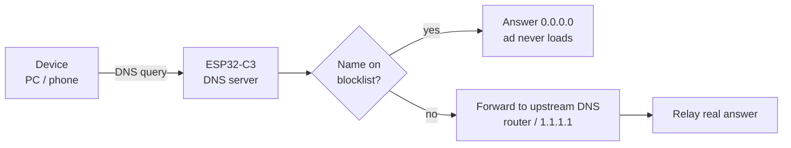

# ESP32-C3 DNS Ad Blocker

A network-wide, Pi-hole-style DNS ad blocker that runs on a ~$2 ESP32-C3 board, written as a single Arduino sketch. Point a device's DNS at the board and ads and trackers served from separate domains simply fail to load.

<!-- Add your screenshots here, e.g.:


-->

## How it works



1. The board listens for DNS queries on UDP port 53.
2. It checks the queried name and each parent domain (`a.b.ads.com`, `b.ads.com`, `ads.com`) against an allowlist, a small built-in list, and a large blocklist.
3. Blocked names get an `A = 0.0.0.0` / `AAAA = ::` reply (other record types get an empty answer so apps give up quickly).
4. Everything else is forwarded upstream and the reply is relayed back unchanged.

### The key trick: hashes in flash, not strings in RAM

The ESP32-C3 has ~400 KB of RAM, far too little to hold tens of thousands of domain strings. Instead the blocklist is stored on the flash filesystem (LittleFS) as **sorted 40-bit hashes, 5 bytes per domain**, and looked up with a **binary search** directly in the file (~17 flash reads per lookup).

| | |
|---|---|
| Entries tested | 77,757 domains (StevenBlack hosts) |
| Flash used | ~380 KB |
| Hash | FNV-1a 64-bit, folded, low 40 bits |
| RAM during normal use | tiny (file is read on demand) |

This idea comes from [M-Abozaid/esp32-c3-adblock](https://github.com/M-Abozaid/esp32-c3-adblock). This repository is an independent Arduino-IDE implementation, see Credits.

## Features

- DNS sinkhole with subdomain matching (blocking `ads.com` also blocks `x.ads.com`).
- Two ways to load the blocklist:
  - **On-device download**: the board fetches a hosts-format list over HTTPS and builds the hash file itself. Because RAM is too small to sort 78k hashes at once, it downloads the list several times, keeping one slice of the hash range per pass, then sorts and appends each slice.
  - **Manual upload**: build `blocklist.bin` on a PC with `tools/build_blocklist.py` and upload it from the web page.
- New list is verified (header, alignment, strictly ascending order) and swapped in only if valid, so a bad update never leaves you with a broken list. DNS keeps answering during updates.
- Small password-protected web page with live stats and the two load buttons (HTTP Basic Auth plus a header check against cross-site requests).
- Wi-Fi auto-reconnect, static IP, small allowlist for connectivity checks.

## Hardware

- Any ESP32-C3 board with 4 MB flash (developed on a C3 SuperMini).
- A USB data cable and a stable USB power source (phone charger or router USB port).

## Quick start (Arduino IDE 2.x)

1. Install the board package: **esp32 by Espressif Systems** (Boards Manager; add `https://espressif.github.io/arduino-esp32/package_esp32_index.json` under Preferences if needed).
2. Select **Tools > Board > ESP32C3 Dev Module**, **USB CDC On Boot: Enabled**, **Partition Scheme: Default 4MB with spiffs (1.2MB APP/1.5MB SPIFFS)**.
3. In `esp32c3_adblock/`, copy `secrets.example.h` to `secrets.h` and fill in your 2.4 GHz Wi-Fi name, password, and a web password.
4. Edit `LOCAL_IP`, `GATEWAY` and `UPSTREAM_DNS` at the top of the sketch for your network.
5. Upload. If it fails to connect, hold **BOOT**, tap **RST**, release BOOT, upload again.
6. Open the Serial Monitor (115200) to see the board join Wi-Fi.
7. Load a blocklist, either wait for the on-device download, or:
   ```
   python tools/build_blocklist.py blocklist.bin
   ```
   then open `http://<board-ip>/`, log in, choose the file, and click **Upload**.

### Test

```
nslookup doubleclick.net <board-ip>    # -> 0.0.0.0 (blocked)
nslookup github.com <board-ip>         # -> real address (forwarded)
```

Then set the board as the DNS server on a device (or in your router's DHCP settings) and browse.

## Things I learned (gotchas)

- **IPv6 DNS can bypass the board.** On Windows, the router's IPv6 DNS was preferred over the manual IPv4 DNS, so nothing was blocked until IPv6 was disabled on the adapter (or the router stops advertising an IPv6 DNS).
- **Browser "Secure DNS" (DoH) skips the board.** Turn it off in Chrome/Edge/Firefox, and set Android "Private DNS" to Off.
- **Some ESP32-C3 SuperMini boards fail to join Wi-Fi at full TX power.** The sketch lowers it (`WIFI_POWER_8_5dBm`).
- **2.4 GHz only.** The C3 can't join 5 GHz; on a combined-band router you may need to split the SSIDs.
- **Arduino prototype generation** places auto-generated function prototypes above sketch-defined classes, so functions taking a sketch-defined type fail to compile. `downloadPass` takes `Stream&` for that reason.
- **A blocked reply must be minimal:** question plus a single answer, with the authority and additional counts zeroed, otherwise clients that send EDNS records treat it as malformed.

## Limitations

- **DNS blocking only works on ads served from their own hostnames.** YouTube video ads and Facebook/Instagram feed ads share domains with the content and will still appear. Sites like large news portals serve some ads first-party, so you will still see some.
- Devices that use their own DNS (DoH, hard-coded resolvers, IPv6 DNS) bypass it.
- If the board loses power, devices pointed at it lose name resolution until their DNS is reset.
- The web page is plain HTTP on the LAN with Basic Auth, which is a LAN-trust control, not encryption.
- The on-device list download currently uses `setInsecure()` (no TLS certificate validation), so a network attacker could in theory feed it a poisoned list. Prefer the manual upload if that matters to you.
- Known issue: on my network the on-device HTTPS download failed with `HTTP -1`; manual upload works. Improved error output was added to help diagnose it.

## Roadmap

- Fix/validate the on-device download and add certificate validation.
- Watchdog and upstream DNS failover.
- Query log and per-domain allow/block from the web page.
- Bucketed index to cut flash reads per lookup.

## Credits

- Hash-in-flash blocklist concept: [M-Abozaid/esp32-c3-adblock](https://github.com/M-Abozaid/esp32-c3-adblock), which in turn credits [s60sc/ESP32_AdBlocker](https://github.com/s60sc/ESP32_AdBlocker). This project is an independent from-scratch Arduino implementation; I have not copied their code.
- Default blocklist: [StevenBlack/hosts](https://github.com/StevenBlack/hosts).

## License

MIT, see [LICENSE](LICENSE). Check the licenses of any blocklists you download.
